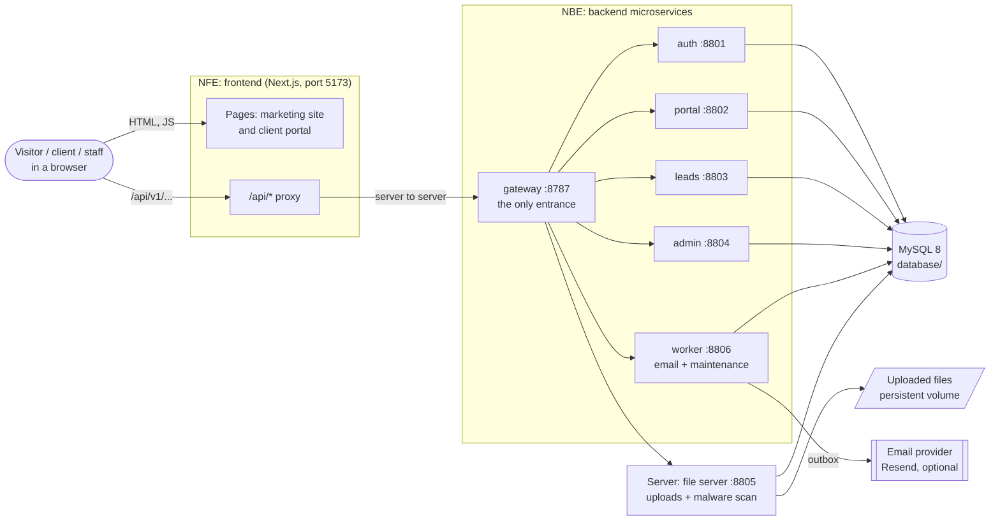
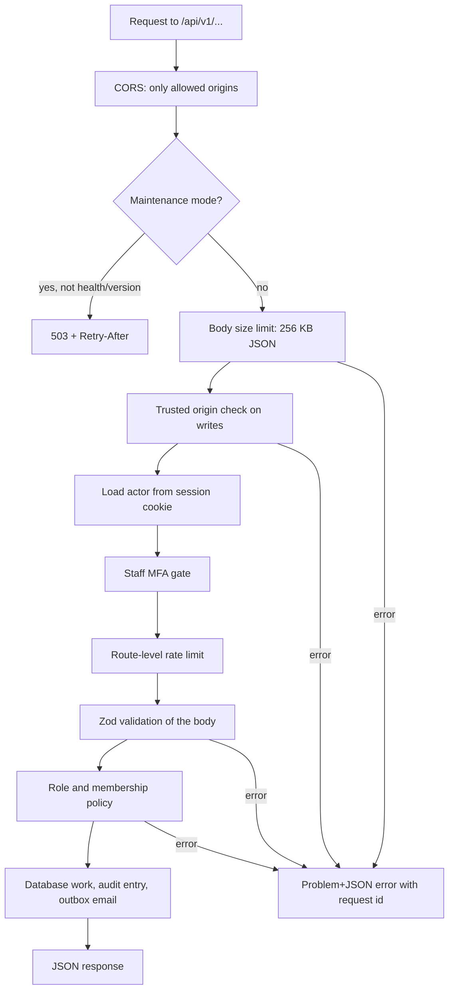
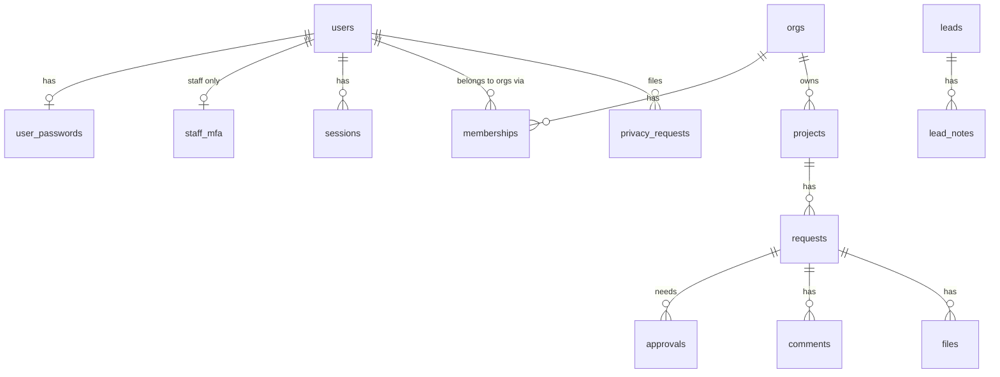
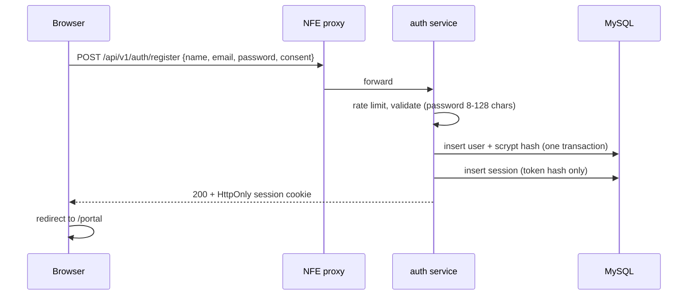
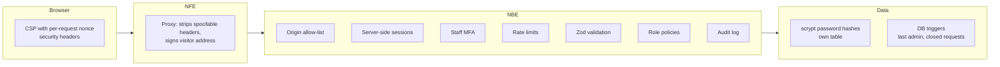
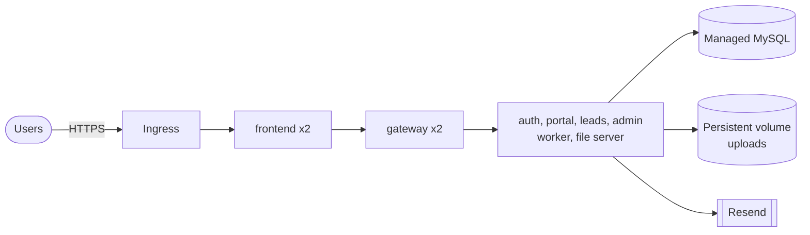

# Neuravic architecture

How the whole system fits together: the website, the API, the database, security and how it runs.
Part of the Neuravic documentation set: **01 Architecture** (this file), [02 Getting started](02-Getting-Started.md), [03 API reference](03-API.md), [04 Security](04-Security.md), [05 Operations](05-Operations.md).

## 1. The system at a glance

A website, a set of small backend services behind one gateway, a file server and a MySQL database.



| Folder | Role | Technology |
|---|---|---|
| [`nfe/`](../nfe) | Frontend: marketing site and client portal | Next.js 16, React 19, TypeScript, Tailwind CSS 4 |
| [`nbe/`](../nbe) | Backend: the shared core plus six services | Node.js 22+, Hono, Zod, Drizzle ORM |
| [`server/`](../server) | File server: stores, scans and serves uploads | Node.js, Hono |
| [`database/`](../database) | MySQL: access setup, migrations, private local server | MySQL 8+, mysql2 |
| [`security/`](../security) | Security tooling: secret generator, secret and dependency scan | Node.js scripts |
| [`test/`](../test) | Unit tests and integration tests | Node test runner, tsx |
| [`images/`](../images) | Brand and documentation images | Image files |
| [`deployment/`](../deployment) | Docker images, Compose, Kubernetes extras, Helm chart | Docker, Kubernetes, Helm |
| [`docs/`](.) | These documents | Markdown |

### Why microservices here

Each service is its own process with its own port, health check, replicas and resource limits, so a busy portal cannot starve sign-in, the file server can be scaled and secured on its own, and the email worker can be paused without touching the API. The services share one MySQL database and one code library (`nbe/core`), which keeps rules such as roles, validation and security in a single place. They do not call each other; the gateway routes requests, and the database is the only shared state. This is a deliberate trade-off: it is simpler to run than one database per service, at the price of a shared schema that changes together.

## 2. The frontend (NFE)

```
nfe/
  app/
    page.tsx              Home page (marketing)
    (auth)/login, signup  Email and password forms
    portal/               Client portal: [section] pages, verify, privacy
    legal/[slug]          Terms, privacy and other legal pages
    api/[...path]/        Server-side proxy to the backend
    layout.tsx            Root layout, carries the CSP nonce
  components/             Site components; components/portal/ holds the portal UI
  lib/                    api.ts (API client), api-proxy.ts, csp.ts, site-content.ts, validation.ts
  proxy.ts                Runs on every page request: builds the CSP with a fresh nonce
  next.config.ts          Security headers and cache rules
```

How a page gets its data:

1. **Marketing content** is read from `GET /content` on the server and falls back to built-in copy (`lib/site-content.ts`) if the API is down, so the home page always renders.
2. **Portal data** is fetched in the browser through `lib/api.ts`, which calls the same domain at `/api/v1/...`.
3. The **proxy** (`lib/api-proxy.ts`) forwards those calls to `API_ORIGIN`. Because the browser only talks to its own domain, the login cookie is first-party and no cross-site cookie rules apply.
4. The proxy strips connection-level and spoofable headers (`x-forwarded-for`, `authorization`, `x-proxy-secret` and similar), and adds the visitor address signed with `API_PROXY_SECRET` when it can be trusted, so rate limits count each visitor separately.

Configuration (`nfe/.env.local`):

| Variable | Purpose |
|---|---|
| `NEXT_PUBLIC_API_BASE_URL` | Where the browser calls the API. Unset in production to use the same-origin proxy |
| `API_ORIGIN` | Backend origin used by the proxy (HTTPS in production) |
| `API_PROXY_SECRET` | Shared secret with the backend (`PROXY_SECRET`), 32+ characters |
| `NEXT_PUBLIC_PORTAL_OPEN` | `true` opens the portal; otherwise visitors see an "under construction" page |

## 3. The backend (NBE and Server)

```
nbe/
  core/src/                 The shared library every service uses
    bootstrap.ts            Builds dependencies and starts one service (port, routes, timers)
    app.ts                  Builds the Hono app: CORS, maintenance mode, body limits, middleware, error mapping
    config.ts, env.ts       Validated configuration (fails fast on bad or missing values)
    deps.ts                 The dependency bundle every route receives (db, mailer, blobs, clock, limiter, ...)
    db/                     MySQL pool, Drizzle schema, atomic batches
    lib/                    crypto, password hashing, rate limiter, body limits, errors, logging, ids
    modules/                One folder per feature (below)
  services/
    gateway/                Routes each request to the service that owns the path
    auth/                   Sign-up, login, sessions, MFA, profile, privacy, single sign-on
    portal/                 Organisations, members, projects, requests, approvals, comments, activity
    leads/                  Website enquiries and the public site content
    admin/                  Staff tools, audit log, security status, content editing
    worker/                 Sends queued email, retries, cleanup and retention (no public routes)
  scripts/smoke.mts         89 checks through the real HTTP API
server/src/index.ts         The file server
```

### Services and what they own

| Service | Port | Paths (under `/api/v1`) | Notes |
|---|---|---|---|
| gateway | 8787 | everything; health and version itself | Public entrance. Keeps cookies, bodies and status codes unchanged. Checks nothing about users: every service still checks origin, session and role |
| auth | 8801 | `/auth/*`, `/me`, `/me/privacy/*`, `/token/*`, `/admin/privacy-requests/*`, `/.well-known/jwks.json` | The only place that creates sessions |
| portal | 8802 | `/orgs/*`, `/projects/*`, `/requests/*` (except files) | Client data, strictly per organisation |
| leads | 8803 | `/leads/*`, `/content/*` | Public input, so it takes the most spam and abuse |
| admin | 8804 | `/admin/*` (except privacy requests) | Staff only; also edits site content |
| files (`server/`) | 8805 | `/requests/:id/files`, `/files/*` | Owns the uploads folder and the malware-scan loop |
| worker | 8806 | `/dev/*` in development only | Sends email, runs maintenance; no business routes |

Gateway rules are plain patterns in `nbe/services/gateway/src/index.ts`; the first match wins and specific paths come first.

### Feature modules (in `nbe/core/src/modules`)

| Module | Purpose |
|---|---|
| `auth` | Password sign-up and login, emailed one-time links, sessions, logout, staff MFA |
| `orgs` | Organisations, members and their roles, invitations |
| `portal` | Projects, requests, approvals, comments, activity |
| `files` | Uploads on requests, malware-scan states, downloads |
| `leads` | Public contact form, staff inbox, lead notes, spam filter |
| `content` | Website text that staff can edit without redeploying |
| `admin` | Staff tools: user list and updates, staff accounts, statistics |
| `privacy` | Account data export and privacy requests (self-service and staff review) |
| `sso` | Short-lived signed tokens for other Neuravic products, with a public JWKS |
| `notifications` | Email outbox and the Resend, dev and console mailers |
| `audit` | Append-only record of security-relevant actions |
| `maintenance` | Outbox retries, cleanup and data retention |

A service is a few lines: it names the routes it owns and starts. For example the portal service mounts `orgsRoutes` and `portalRoutes` and nothing else.

### Request pipeline

Every API call passes the same checks in this order:



All errors use one shape (`application/problem+json` with `status`, `code`, `title`, `requestId`). Unknown errors return a generic 500 and are logged without user data.

## 4. Data model



Other tables: `auth_tokens` (one-time links), `content_items` (editable site content), `outbox` (emails waiting to be sent), `audit_log`, `rate_limits`.

Conventions: ids are ULIDs (sessions and tokens use a SHA-256 hash), all times are UTC epoch milliseconds, text is compared byte for byte (`utf8mb4_bin`). Some rules are enforced by database triggers as well as code, for example "at least one active staff admin must exist" and "a closed request accepts no files", so a race between two requests cannot break them.

### People and roles

| Kind | Values | Meaning |
|---|---|---|
| Staff role | `admin`, `delivery`, `sales` | Neuravic team. Admin manages staff and content |
| Organisation role | `viewer`, `member`, `admin`, `owner` | A client inside one organisation. The last owner can never be removed |
| Account status | `invited`, `active`, `disabled` | Disabled accounts cannot sign in |

## 5. Main flows

### Sign up and log in with a password



Login is the same shape through `POST /auth/login`. A wrong password and an unknown email return the same 401 after the same amount of work, so the form cannot be used to find out who has an account.

### Emailed one-time link (optional, and used for invitations)

`POST /auth/magic-link` queues an email with a single-use token (15 minutes). The link carries the token in the URL fragment (`/portal/verify#token=...`) so it is never sent to a web server or a Referer header. `POST /auth/verify` exchanges it for a session.

### A client request with approval

1. A member opens a request on a project (`access`, `change`, `support` or `other`).
2. Approvers in the organisation approve or reject it; the database checks the approver is allowed.
3. Comments and files attach to the request. Files stay quarantined until the malware scanner clears them.
4. Every step writes an audit entry and, where relevant, an email to the outbox.

### Email delivery

Routes never send email directly. They write to the `outbox` table in the same transaction as the change, and a background task delivers it. If the provider fails, the 5 minute maintenance job retries; after repeated failure the message is marked `dead`. This means a sign-up never fails because the mail provider is down.

## 6. Security architecture



| Area | How it is handled |
|---|---|
| Passwords | scrypt (N=16384, r=8, p=1) with a random salt per password, stored in `user_passwords` so no listing can return them. Login does equal work for unknown emails |
| Sessions | Random 256-bit token in an `HttpOnly`, `SameSite=Lax` cookie (`__Host-nv_session` and `Secure` outside development, `nv_session` in development). Only its SHA-256 hash is stored. Clients: 30 days idle, 90 days absolute. Staff: 12 hours |
| Staff MFA | Authenticator codes and recovery codes; required in staging and production; a session without proof is limited and expires |
| Cross-site requests | Writes must come from an allowed origin; CORS only lists `ALLOWED_ORIGINS` |
| Rate limiting | Database-backed fixed windows per IP and per account (login 30 per 15 min per IP and 10 per 15 min per email; register, sign-up and contact have their own limits) |
| Input | Every body is validated with Zod; JSON is capped at 256 KB; uploads have their own larger limit |
| Authorisation | Each route checks the staff role or organisation role; people only ever see their own organisations |
| Browser protection | Content-Security-Policy with a fresh nonce per page, `frame-ancestors 'none'`, HSTS, `nosniff`, strict referrer and permissions policies, `no-store` on portal pages |
| Files | Size and type checks, quarantine until scanned, downloads served through the API with access checks |
| Privacy | Pseudonymous hashing of IPs and user agents in the audit log, data export, privacy requests, retention windows enforced by the maintenance job |
| Secrets | Only in environment files that are git-ignored; `security/scripts/security-check` scans for leaked secrets and vulnerable dependencies weekly and in CI |
| Contact spam | Honeypot field, spam scoring, per-address and per-IP limits (no third-party captcha) |

The threat model, required production settings and the go-live checklist are in [04 Security](04-Security.md).

## 7. Background work

| Where | What | When |
|---|---|---|
| worker | Sends queued email, with retries and growing delays | every 2 seconds (`WORKER_POLL_MS`) |
| worker | Cleanup (expired sessions, used tokens, old rate-limit rows) and retention: spam leads after 90 days, lost leads after 365, sent outbox rows after 30, dead ones after 90 | every 5 minutes |
| file server | Scans files waiting for the malware check | every 30 seconds |

Only the worker delivers email. Every other service writes to the `outbox` table in the same transaction as its change, so a sign-up never fails because the mail provider is down. All steps are safe to repeat, so running two copies only repeats work.

## 8. Environments and deployment

| | Development | Production |
|---|---|---|
| Frontend | `npm run dev` on 5173 | Container image behind an HTTPS ingress |
| Backend | `npm start` at the repo root runs all services | One container per service, started from one image |
| Database | `npm run db:local` (private MySQL on 3307) | Managed MySQL 8+ |
| Email | In-memory dev mailbox | Resend (`RESEND_API_KEY`) |
| Files | `.data/files/` | A persistent volume mounted on the file server |
| Staff MFA | Off by default | Required |



How it is packaged ([`deployment/`](../deployment)):

| Piece | What it is |
|---|---|
| `docker/backend.Dockerfile` | One image for every backend service and the file server; the `ENTRY` setting picks which one runs |
| `docker/frontend.Dockerfile` | The website image |
| `docker-compose.yml` | The whole system on one machine: MySQL, migration, seven backend containers and the website |
| `helm/neuravic` | The Helm chart: a Deployment and Service per service, the file volume, ingress, a pre-upgrade migration job, network policies, disruption budgets and optional autoscaling |
| `k8s/` | Namespace with the "restricted" pod standard, an example Secret and a test-only MySQL |

Release order, rollback and day-to-day operation are in [05 Operations](05-Operations.md).

## 9. Testing and quality

| Check | Command | Covers |
|---|---|---|
| Unit tests | `npm run test:unit` at the repo root | 101 tests with no database or network: password hashing, crypto helpers, pagination, body limits, JSON validation, configuration rules, TOTP codes, session lifetimes, rate limiter, visitor address trust, gateway routing, spam score, single sign-on tokens, the website's form checks and CSP |
| Integration tests | `npm start`, then `npm run test:integration` | 52 tests through the real gateway, services and MySQL: gateway routing and CORS, accounts and sessions, organisation isolation, roles, approvals, files and the scanner, enquiries, staff tools, privacy |
| API smoke test | `npm run smoke` at the repo root | 89 checks through the real gateway: accounts, passwords, portal, files, staff tools, privacy, safety rules |
| Types | `npm run typecheck` at the repo root; `npm run typecheck` in `nfe` | Every backend package and the frontend |
| Frontend | `cd NFE && npm run lint && npm run build` | Code quality and a production build |
| Chart | `helm lint deployment/helm/neuravic` and `helm template` | The Kubernetes manifests render and lint |
| Security | `npm run security` | Secret scan and dependency advisories for the backend and `nfe` |
| CI | `.github/workflows` | Frontend checks, weekly security check, CodeQL |

## 10. Known gaps

- Real email has to be configured before production (no email means invitations and link sign-in cannot reach people).
- There is no captcha on the public forms; protection is rate limits, a honeypot and spam scoring. Add one if abuse appears.
- Password reset by email is not built yet; people without a password can use the emailed sign-in link.
- Uploaded files live on one volume, so the file server runs a single replica; move to object storage to scale it out.
- The services share one database schema. If a service ever needs to be developed or released fully on its own, give it its own tables first.
- The Docker images and the Helm chart have been linted and rendered but not run on a cluster from this repository; try them in staging first.
- The integration tests and the smoke test need running services and a development database. There are no browser end-to-end tests for the website yet.
