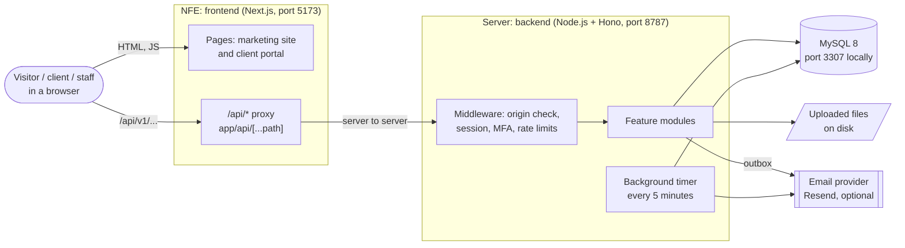
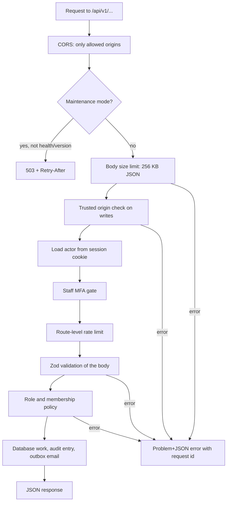
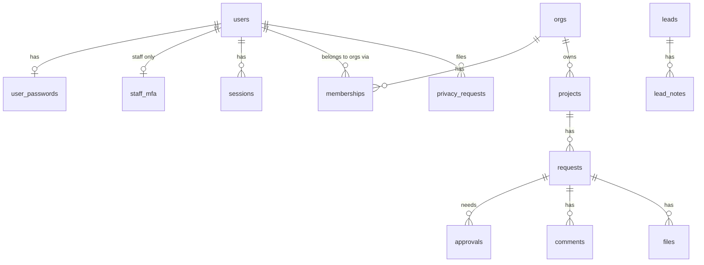
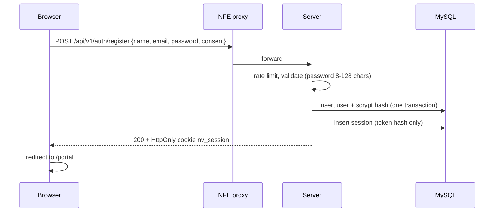
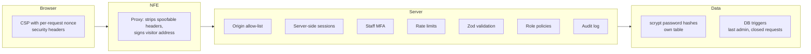
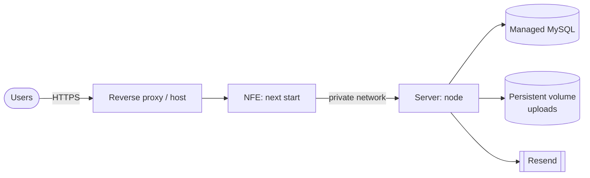

# Neuravic architecture

How the whole system fits together: the website, the API, the database, security and how it runs.
For the endpoint list see [`API.md`](API.md). For setup steps see the [root README](../README.md).

## 1. The system at a glance

Two programs and one database. Nothing else is required to run Neuravic.



| Part | Folder | Technology | Role |
|---|---|---|---|
| Frontend | [`NFE/`](../NFE) | Next.js 16, React 19, TypeScript, Tailwind CSS 4 | Marketing site and the client portal |
| Backend | [`Server/`](../Server) | Node.js 22+, Hono, Zod, Drizzle ORM | The API: accounts, projects, requests, files, content, enquiries |
| Database | `Server/sql/` | MySQL 8+ | All data, plus rate-limit counters and the email outbox |
| Security docs | [`Security/`](../Security) | Markdown and scripts | Policy, threat model, automated secret and dependency check |

## 2. The frontend (NFE)

```
NFE/
  app/
    page.tsx              Home page (marketing)
    (auth)/login, signup  Email and password forms
    portal/               Client portal: [section] pages, verify, privacy
    legal/[slug]          Terms, privacy and other legal pages
    api/[...path]/        Server-side proxy to the backend
    layout.tsx            Root layout, carries the CSP nonce
  components/             Site components; components/portal/ holds the portal UI
  lib/                    api.ts (API client), api-proxy.ts, csp.ts, site-content.ts, validation.ts
  proxy.ts                Runs on every page request: builds the CSP with a fresh nonce
  next.config.ts          Security headers and cache rules
```

How a page gets its data:

1. **Marketing content** is read from `GET /content` on the server and falls back to built-in copy (`lib/site-content.ts`) if the API is down, so the home page always renders.
2. **Portal data** is fetched in the browser through `lib/api.ts`, which calls the same domain at `/api/v1/...`.
3. The **proxy** (`lib/api-proxy.ts`) forwards those calls to `API_ORIGIN`. Because the browser only talks to its own domain, the login cookie is first-party and no cross-site cookie rules apply.
4. The proxy strips connection-level and spoofable headers (`x-forwarded-for`, `authorization`, `x-proxy-secret` and similar), and adds the visitor address signed with `API_PROXY_SECRET` when it can be trusted, so rate limits count each visitor separately.

Configuration (`NFE/.env.local`):

| Variable | Purpose |
|---|---|
| `NEXT_PUBLIC_API_BASE_URL` | Where the browser calls the API. Unset in production to use the same-origin proxy |
| `API_ORIGIN` | Backend origin used by the proxy (HTTPS in production) |
| `API_PROXY_SECRET` | Shared secret with the backend (`PROXY_SECRET`), 32+ characters |
| `NEXT_PUBLIC_PORTAL_OPEN` | `true` opens the portal; otherwise visitors see an "under construction" page |

## 3. The backend (Server)

```
Server/
  src/
    server.ts        Entry point: builds dependencies, starts the HTTP server and the 5 minute timer
    app.ts           Builds the Hono app: CORS, maintenance mode, body limits, middleware, routes, error mapping
    config.ts, env.ts  Validated configuration (fails fast on bad or missing values)
    deps.ts          The dependency bundle every route receives (db, mailer, blobs, clock, limiter, ...)
    db/              MySQL pool, Drizzle schema, atomic batches
    lib/             crypto, password hashing, rate limiter, body limits, errors, logging, ids
    modules/         One folder per feature (below)
  sql/               Numbered, forward-only migrations (001_init, 002_passwords)
  scripts/           migrate.ts, mysql-local.mjs, smoke.ts
  uploads/           Stored files (development default)
```

### Feature modules

| Module | Purpose |
|---|---|
| `auth` | Password sign-up and login, emailed one-time links, sessions, logout, staff MFA |
| `orgs` | Organisations, members and their roles, invitations |
| `portal` | Projects, requests, approvals, comments, activity |
| `files` | Uploads on requests, malware-scan states, downloads |
| `leads` | Public contact form, staff inbox, lead notes, spam filter |
| `content` | Website text that staff can edit without redeploying |
| `admin` | Staff tools: user list and updates, staff accounts, statistics |
| `privacy` | Account data export and privacy requests (self-service and staff review) |
| `sso` | Short-lived signed tokens for other Neuravic products, with a public JWKS |
| `notifications` | Email outbox and the Resend, dev and console mailers |
| `audit` | Append-only record of security-relevant actions |
| `maintenance` | Outbox retries, cleanup and data retention |

### Request pipeline

Every API call passes the same checks in this order:



All errors use one shape (`application/problem+json` with `status`, `code`, `title`, `requestId`). Unknown errors return a generic 500 and are logged without user data.

## 4. Data model



Other tables: `auth_tokens` (one-time links), `content_items` (editable site content), `outbox` (emails waiting to be sent), `audit_log`, `rate_limits`.

Conventions: ids are ULIDs (sessions and tokens use a SHA-256 hash), all times are UTC epoch milliseconds, text is compared byte for byte (`utf8mb4_bin`). Some rules are enforced by database triggers as well as code, for example "at least one active staff admin must exist" and "a closed request accepts no files", so a race between two requests cannot break them.

### People and roles

| Kind | Values | Meaning |
|---|---|---|
| Staff role | `admin`, `delivery`, `sales` | Neuravic team. Admin manages staff and content |
| Organisation role | `viewer`, `member`, `admin`, `owner` | A client inside one organisation. The last owner can never be removed |
| Account status | `invited`, `active`, `disabled` | Disabled accounts cannot sign in |

## 5. Main flows

### Sign up and log in with a password



Login is the same shape through `POST /auth/login`. A wrong password and an unknown email return the same 401 after the same amount of work, so the form cannot be used to find out who has an account.

### Emailed one-time link (optional, and used for invitations)

`POST /auth/magic-link` queues an email with a single-use token (15 minutes). The link carries the token in the URL fragment (`/portal/verify#token=...`) so it is never sent to a web server or a Referer header. `POST /auth/verify` exchanges it for a session.

### A client request with approval

1. A member opens a request on a project (`access`, `change`, `support` or `other`).
2. Approvers in the organisation approve or reject it; the database checks the approver is allowed.
3. Comments and files attach to the request. Files stay quarantined until the malware scanner clears them.
4. Every step writes an audit entry and, where relevant, an email to the outbox.

### Email delivery

Routes never send email directly. They write to the `outbox` table in the same transaction as the change, and a background task delivers it. If the provider fails, the 5 minute maintenance job retries; after repeated failure the message is marked `dead`. This means a sign-up never fails because the mail provider is down.

## 6. Security architecture



| Area | How it is handled |
|---|---|
| Passwords | scrypt (N=16384, r=8, p=1) with a random salt per password, stored in `user_passwords` so no listing can return them. Login does equal work for unknown emails |
| Sessions | Random 256-bit token in an `HttpOnly`, `SameSite=Lax` cookie (`Secure` outside development). Only its SHA-256 hash is stored. Clients: 30 days idle, 90 days absolute. Staff: 12 hours |
| Staff MFA | Authenticator codes and recovery codes; required in staging and production; a session without proof is limited and expires |
| Cross-site requests | Writes must come from an allowed origin; CORS only lists `ALLOWED_ORIGINS` |
| Rate limiting | Database-backed fixed windows per IP and per account (login 30 per 15 min per IP and 10 per 15 min per email; register, sign-up and contact have their own limits) |
| Input | Every body is validated with Zod; JSON is capped at 256 KB; uploads have their own larger limit |
| Authorisation | Each route checks the staff role or organisation role; people only ever see their own organisations |
| Browser protection | Content-Security-Policy with a fresh nonce per page, `frame-ancestors 'none'`, HSTS, `nosniff`, strict referrer and permissions policies, `no-store` on portal pages |
| Files | Size and type checks, quarantine until scanned, downloads served through the API with access checks |
| Privacy | Pseudonymous hashing of IPs and user agents in the audit log, data export, privacy requests, retention windows enforced by the maintenance job |
| Secrets | Only in environment files that are git-ignored; `Security/scripts/security-check` scans for leaked secrets and vulnerable dependencies weekly and in CI |
| Contact spam | Honeypot field, spam scoring, per-address and per-IP limits (no third-party captcha) |

Required production settings and the go-live list are in [`../Security/`](../Security): `APP_ENV=production`, HTTPS origins, a real `PRIVACY_HASH_SECRET`, `MFA_ENCRYPTION_KEY`, `PROXY_SECRET`, and an email provider key.

## 7. Background work

One timer in the server process runs every 5 minutes (`modules/maintenance`):

- send queued emails and retry failures
- scan files waiting for the malware check
- delete expired sessions, used tokens and old rate-limit rows
- apply retention: spam leads after 90 days, lost leads after 365, sent outbox rows after 30, dead ones after 90

If you run more than one server process, only the work is repeated, not harmed: every step is idempotent.

## 8. Environments and deployment

| | Development | Production |
|---|---|---|
| Frontend | `npm run dev` on 5173 | `npm run build` then `npm start`, behind HTTPS |
| Backend | `npm start` on 127.0.0.1:8787 | Node process behind HTTPS with `APP_ENV=production` |
| Database | `npm run mysql:local` (private MySQL on 3307) | Managed MySQL 8+ via `DATABASE_URL` |
| Email | In-memory dev mailbox at `/api/v1/dev/mailbox` | Resend (`RESEND_API_KEY`) |
| Files | `Server/uploads/` | A persistent volume (`UPLOAD_DIR`) |
| Staff MFA | Off by default | Required |



Release steps: build the frontend, run `npm run migrate` against the production database, start the backend, then the frontend. Migrations are forward only: every schema change is a new numbered file in `Server/sql/`.

## 9. Testing and quality

| Check | Command | Covers |
|---|---|---|
| API smoke test | `cd Server && npm start`, then `npm run smoke` | 89 checks through the real HTTP API: accounts, passwords, portal, files, staff tools, privacy, safety rules |
| Frontend | `cd NFE && npm run lint && npm run typecheck && npm run build` | Code quality, types, production build |
| Security | `./Security/scripts/security-check.sh` | Secret scan and dependency advisories for `Server` and `NFE` |
| CI | `.github/workflows` | Frontend checks, weekly security check, CodeQL |

## 10. Known gaps

- Real email has to be configured before production (no email means invitations and link sign-in cannot reach people).
- There is no captcha on the public forms; protection is rate limits, a honeypot and spam scoring. Add one if abuse appears.
- Password reset by email is not built yet; people without a password can use the emailed sign-in link.
- Uploaded files live on one disk; use a persistent volume, or move to object storage if you run several servers.
- The backend smoke test needs a running server and database; there is no isolated unit test suite for `Server` yet.
